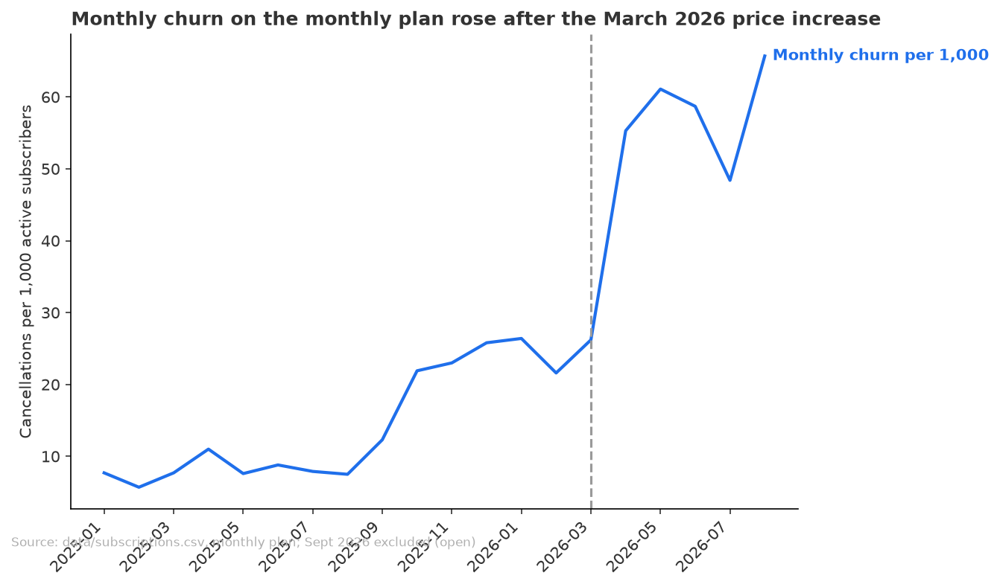
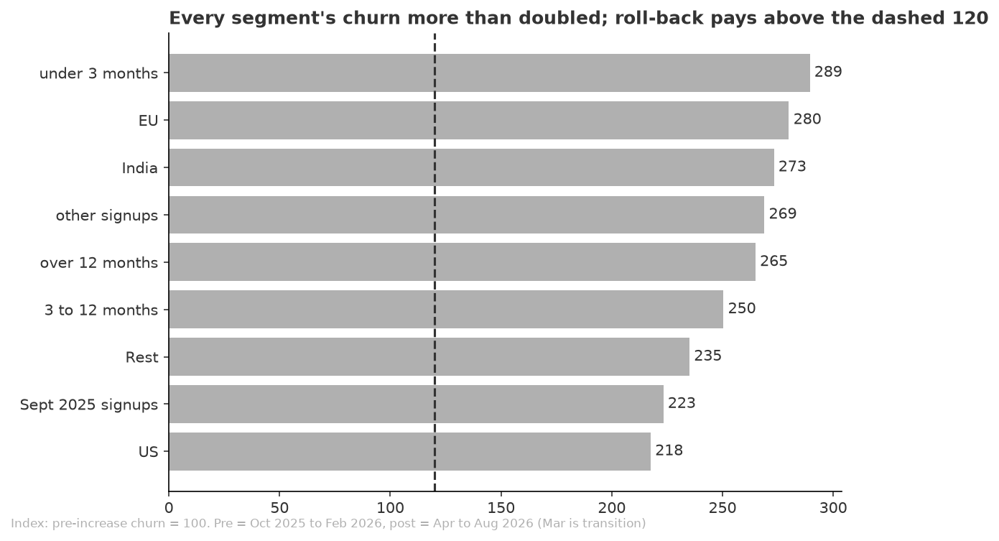

# The March price increase more than doubled monthly-plan churn, and every segment is above the point where a rollback pays

**Date:** 2026-11-10
**For:** Head of growth
**Data runs to:** 2026-09-24
**Run folder:** outputs/2026-11-10_march-price-increase-retention/

## Objective
Did raising the monthly plan from $10 to $12 in March 2026 hurt retention, and for whom? The head of growth is deciding whether to roll the increase back for some customers. We define retention as monthly churn: the cancellations in a month as a share of monthly-plan subscribers active at the start of it. A rollback pays for a segment when churn rose by more than 20% relative, since the new price is 20% higher than the old.

## Key Takeaways
- Monthly-plan churn rose from 23.7 to 57.9 cancellations per 1,000 subscribers per month after the increase, up 144% relative, or 34.2 more per 1,000. Comparison: October 2025 to February 2026 against April to August 2026.
- The annual plan, which was not repriced, did not move: 5.5 before and 5.3 after per 1,000, so the rise is specific to the monthly plan.
- About 917 of the 1,553 cancellations from April to August 2026 are beyond what the earlier churn rate would have produced.
- Every segment is far above the 20% break-even: churn is 2.2 to 2.9 times its earlier level in each country, device type, tenure band and signup cohort.
- Newest subscribers react most: those under three months churn at 96.3 per 1,000 against 33.3 before. Subscribers over 12 months churn at 32.0 against 12.1 before. iOS and the US have the lowest churn, Web and India the highest.

## Recommendations
1. Roll back, or test a rollback, on the monthly plan. The excess churn is beyond the break-even in every segment, so the case does not depend on picking the right group. Follows from takeaways 1, 2 and 4.
2. If the rollback is only partial, start with subscribers in their first three months, then Web, India and EU. They churn most and had the largest rise. Follows from takeaway 5.
3. Run it as a test with a $12 holdout for a few months before deciding on a permanent price, because the monthly plan has no untreated group today.

## Analysis
### Monthly churn stepped up in April 2026, the first month after renewals at $12

Churn on the monthly plan held between 6 and 11 per 1,000 through August 2025, rose to 22 to 26 after the September 2025 signup spike, then jumped to 55 in April 2026 and stayed above 48. March 2026 itself was 26.2, level with the months before: March renewals were the first at $12 and the cancellations follow in April, so March is left out of both windows. Including it gives an index of 221 instead of 244. Source: `data/monthly_churn_series.csv`, monthly plan, scheduled starts excluded, September 2026 excluded because it is still open.

### Churn rose in every segment, by a factor of 2.2 to 2.9 against a break-even of 1.2

Index = post churn divided by pre churn, with 100 meaning no change. Under three months scores 289 and EU 280, and the US is lowest at 218. All are beyond the dashed break-even at 120, and each country, device, tenure and cohort split adds back to the same 1,553 cancellations. The spread between segments is small compared with the rise itself, so the segments mostly tell you where churn is highest, not where the rise happened. Source: `data/segment_pre_post.csv`.

## Checks
**Review verdict:** Think on it

**Verified**
- Joining subscriptions to users by user_id does not duplicate rows (30,747 of 30,747).
- The $12 price reached existing subscribers: 100% of their payments from March 2026 are at $12 and none before.
- Cancellations by country, device, tenure and cohort add back to the same total (1,553).
- Churn was recounted from subscription end dates and matched the script.
- The annual plan, as a control, shows no change (index 97 against 244 for monthly).

**Changed after review**
- Added the annual plan as a control group. No headline number changed.
- Before the review, the post window moved from March to August to April to August because March shows no step; this changed the monthly index from 221 to 244.

**Not verified**
- Every monthly subscriber was repriced, so there is no untreated monthly group. The annual plan is the only control, and it is a different type of customer.
- The pre-increase baseline is itself higher than early 2025 (23.7 against 8.0 per 1,000), after the September 2025 spike. The size of the rise depends on the baseline chosen.
- Segments were not tested against each other, so small differences between them should not be acted on alone.
- The significance tests treat each subscriber-month as independent, which overstates certainty.
- No dollar estimate of a rollback; the 20% break-even is a steady-state rule that ignores discounting and a different mix of new customers.
- The September 2025 spike and the August 2026 change of status label from "expired" to "canceled" were not explained.

**Source**
- Script: `analysis.py`. Tables: `data/monthly_churn_series.csv`, `data/overall_pre_post.csv`, `data/segment_pre_post.csv`, `data/annual_control.csv`, `data/extra_cancellations.csv`.
