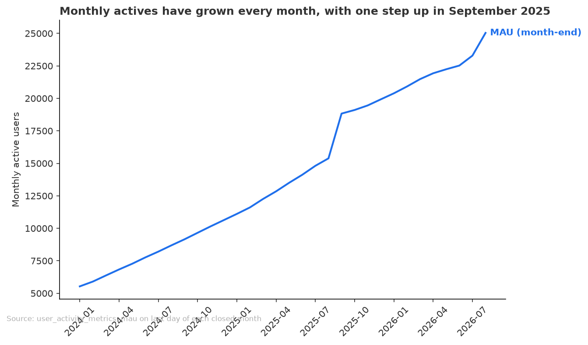
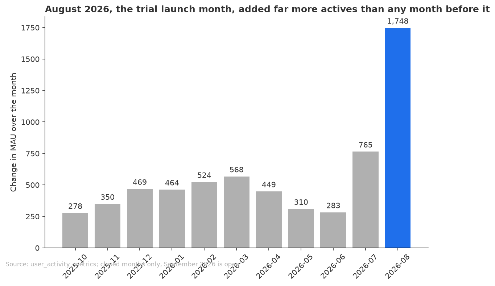

# Monthly actives are up 63% in a year and jumped in the trial launch month, but the data cannot yet credit the trial

**Date:** 2026-11-10
**For:** Head of growth
**Data runs to:** 2026-09-24
**Run folder:** outputs/2026-11-10_monthly-active-users-trial-launch/

## Objective
Are monthly active users up over the last two years, and what happened around the trial launch on 2026-08-01? The head of growth will use this to decide whether to keep funding the trial programme or move that budget to retention offers. No threshold for "enough lift" was set, so this brief gives a direction, not a pass or fail.

## Key Takeaways
- Monthly active users were 25,037 at the end of August 2026, up 62.8% (relative) on 15,383 a year earlier, and they have risen in every closed month since February 2024.
- About 2,928 of that 9,654-user yearly gain is a one-off step in September 2025; underlying monthly gains were about 518 before it and 446 after it, so growth was a little slower before the launch.
- The launch month, August 2026, added 1,748 actives against an average of 446 a month from October 2025 to July 2026 (highest earlier month 765).
- Signups in August 2026 were 2,315 against a January to July average of 668, and 1,180 trials started; September to the 24th is still open (1,805 signups, 893 trials).
- Of 1,516 trials that have finished, 53.2% converted to a paid plan (807) and 46.8% were canceled (709); no comparison is available because trials did not exist before the launch.
- The lift cannot be credited to the trial alone: signups not tied to a trial also rose, from 155 a week (May to July) to 260 a week (3 August to 14 September).

## Recommendations
1. Keep funding the trial programme for now, as the launch coincides with the biggest monthly gain in the window and over half of finished trials convert. This follows from takeaways 3 and 5, and it is a hold, not a commitment.
2. Before moving budget, find out what else changed at launch (for example marketing or onboarding), since non-trial signups rose too (takeaway 6). The head of growth or marketing can answer this.
3. Revisit in about two months with retention data on converted trial users. None exists yet: the oldest conversion is about six weeks old. This is the evidence that would show whether retention offers are the better use of the money.

## Analysis
### Monthly actives have grown every month for two years, with one step up in September 2025

Month-end monthly actives rose from 5,533 in January 2024 to 25,037 in August 2026. The September 2025 step is a known anomaly (a signup spike about five times a normal month), and it sits inside every year-over-year comparison. Source: `data/mau_monthly.csv`, last day of each closed month; September 2026 is open and excluded.

### August 2026 added far more actives than any month since the September 2025 step

The 1,748 gain in August 2026 compares with 446 on average over October 2025 to July 2026, and 666 so far in September (24 days, open, not comparable). The gain came with more than three times the usual signups, and weekly signups not linked to a trial also rose. Source: `data/mau_monthly.csv`, `data/signups_trials_monthly.csv`, `data/weekly_signups_split.csv`.

## Checks
**Review verdict:** Think on it

**Verified**
- Joins from trials and subscriptions to users did not multiply rows (`join_fan_out`).
- Finished trials only: 557 of 2,073 were excluded as still open (`matured_only`), and the outcomes add up to the 1,516 total (`parts_sum_to_total`).
- Monthly actives are taken on the last day of each month, because the figure is a rolling window; the open month is flagged (`date_boundaries`).

**Changed after review**
- Added a weekly signup split and a check that every closed month rose. No headline number changed.

**Not verified**
- The lift cannot be attributed to the trial: non-trial signups rose at the same time, and the activity table has no user level. (caveat)
- Year-over-year growth is inflated by the September 2025 spike. (caveat)
- Paid starts not tied to trials were 649 in July 2026 against 247 to 286 in earlier months, then 90 in August; the data does not explain it. (caveat)
- Whether converted trial users stay, the value of conversions against programme cost, the cause of either spike, and any marketing change at launch were not checked.

**Source**
- `analysis.py`; tables in `data/`: `mau_monthly.csv`, `signups_trials_monthly.csv`, `weekly_signups_split.csv`, `trial_conversion_weekly.csv`, `paid_starts_monthly.csv`.
