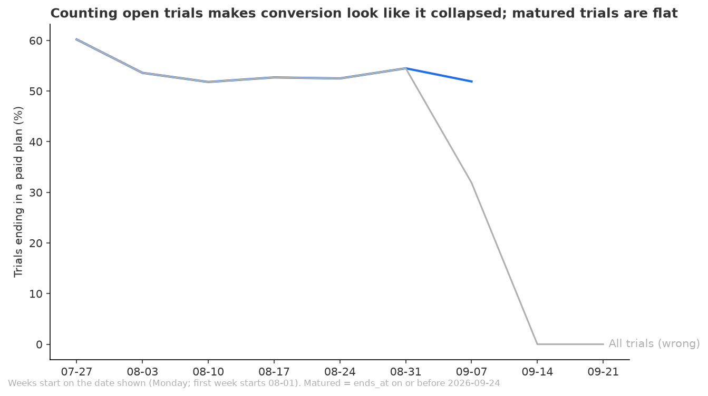
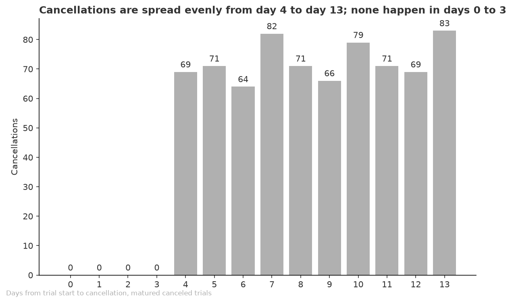

# The 14-day trial converts steadily at 53%, and the apparent recent drop is open trials, not lost customers

**Date:** 2026-11-10
**For:** Head of growth
**Data runs to:** 2026-09-24
**Run folder:** outputs/2026-11-10_trial-conversion-weekly/

## Objective
How is the 14-day trial converting since its launch on 2026-08-01, and is that changing week over week? The head of growth is deciding whether to keep the trial at 14 days or change its length. No target conversion rate was given, so no threshold would trigger a change. A trial converts when a paid subscription starts at the end of it.

## Key Takeaways
- 53.3% of trials that have finished converted to a paid plan (828 of 1,553 matured trials), against 39.9% if the 520 trials still open are counted as failures.
- The weekly rate is flat: weeks that have matured sit between 51.8% and 54.5%, apart from the launch weekend at 60.2%, and the earlier half against the later half is down 1.6 percentage points (p=0.52), or up 0.1 percentage points without the launch weekend.
- The drop to 32% and 0% in the latest weeks is an artefact: trials started on 2026-09-11 or later have not reached day 14 and cannot yet show a conversion.
- Cancellations start on day 4 and are spread evenly through day 13, and 72% of them fall on days 7 to 13.
- All trials are 14 days long, so the data shows stable conversion at 14 days but cannot say whether another length would convert more.

## Recommendations
1. Keep the trial at 14 days for now. Conversion is stable and nothing in the data shows a decline. Follows from takeaways 1 and 2.
2. Do not read the latest weekly figures from the raw trials table; use only trials that have ended. Follows from takeaway 3.
3. To decide on a different length, run a test with a second length (for example 7 days) on a share of new trials, and set the conversion rate that would count as a win before it starts. Follows from takeaways 4 and 5.

## Analysis
### Conversion is flat across the weeks that have matured, while counting open trials makes it look like a collapse

Matured trials (blue) run between 51.8% and 54.5% by start week, after the first two days at 60.2% (88 trials). Counting every trial (grey) falls to 31.9% for the week of 09-07 and 0% for the weeks after, because those trials have no outcome yet. Rates are shown to the week of 09-07, where 160 of 260 trials have matured; the two latest weeks have none. Source: `data/weekly_conversion.csv`, matured = trial end on or before 2026-09-24.

### Trials that cancel do so from day 4 onward, with no concentration at the end

No trial cancels in the first four days. From day 4 through day 13 the count stays between 64 and 83 per day, so the end of the trial is not where people leave. This does not show whether a shorter or longer trial would change that. Source: `data/days_to_cancel.csv`, matured canceled trials.

### The overall rate is 53.3%, with Web the lowest segment at 48.1% and iOS the highest at 57.1%
Segments against the overall 53.3%: iOS +3.8 percentage points, US +3.4, Android +1.2, Rest -1.2, India -2.6, EU -3.3, Web -5.2. Each split adds back to the 1,553 matured trials. These gaps were not tested against each other. Among the 828 converters, 590 chose the monthly plan and 238 the annual plan. Source: `data/segment_conversion.csv`, `data/plan_of_converters.csv`.

## Checks
**Review verdict:** Think on it

**Verified**
- 1,553 trials have ended and 828 converted (53.3%), recounted outside the script with the same result; none of the ended trials has an empty outcome.
- Trials join to users and subscriptions without creating duplicate rows.
- The trial outcome agrees with the subscriptions table on all 2,073 trials, and every paid plan starts on the trial's end date.
- Country and device splits each add back to 1,553.

**Changed after review**
- None.

**Not verified**
- The data holds one trial length, so no comparison between lengths is possible.
- The 520 trials started on 2026-09-11 or later are not included; the newest result covers trials started up to 2026-09-10, and the week of 2026-09-07 is partial (160 of 260).
- Why the launch weekend converted higher (60.2% on 88 trials) was not examined.
- Segment differences, for example Web at 48.1% against iOS at 57.1%, were not tested.
- Revenue per converted trial, including the monthly against annual choice, was not compared.

**Source**
- Script: `analysis.py`. Tables: `data/weekly_conversion.csv`, `data/trend_first_vs_second_half.csv`, `data/segment_conversion.csv`, `data/days_to_cancel.csv`, `data/plan_of_converters.csv`.
