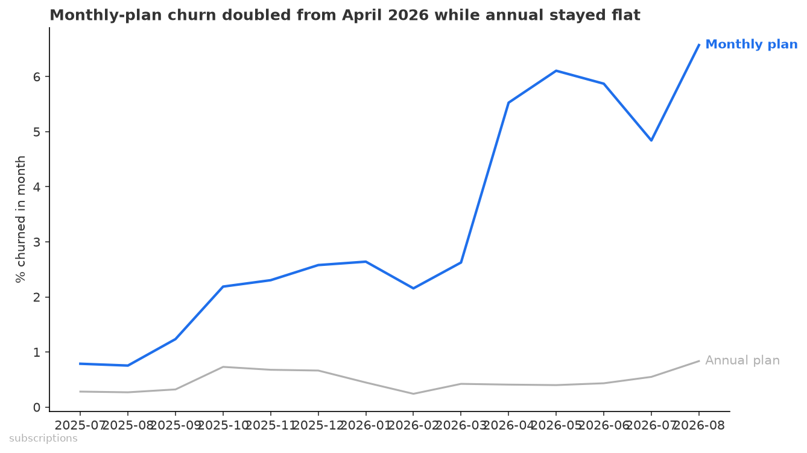
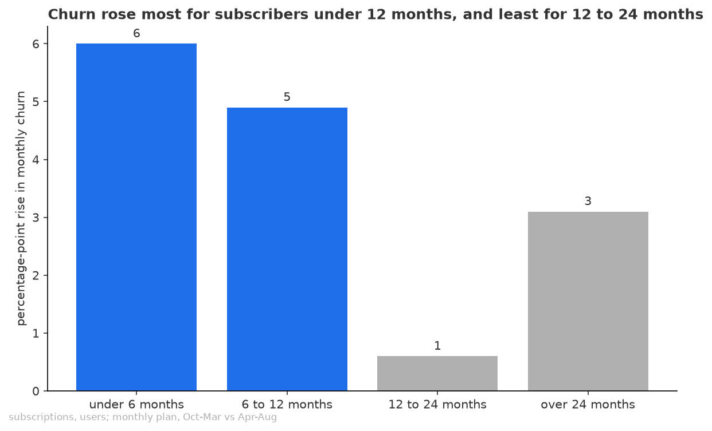

# Monthly churn more than doubled after the March price rise, hardest among newer subscribers, but the extra revenue still outweighs the loss

**Date:** 2026-11-23
**For:** Head of growth
**Data runs to:** 2026-09-24
**Run folder:** outputs/2026-11-23_march-price-increase-retention/

## Objective
Did the March 2026 price increase (monthly plan from $10 to $12) hurt retention, and for which customers? The head of growth decides whether to roll back part of the increase for some customers. No threshold was set for how big a drop justifies a rollback, so this brief shows the direction and the size, not a pass or fail.

## Key Takeaways
- Monthly-plan churn rose from 2.42% a month (Oct 2025 to Mar 2026) to 5.79% a month (Apr to Aug 2026), up 3.37 percentage points, or 140% relative.
- Annual-plan churn did not move over the same dates: 0.52% before against 0.53% after, up 0.01 percentage points.
- Every segment got worse, but unevenly: subscribers under 6 months rose 6.03 percentage points (3.45% to 9.49%) and those at 6 to 12 months rose 4.95 points, while those at 12 to 24 months rose only 0.59 points.
- By country and device, India (+4.26 points), Web signups (+4.00) and Android signups (+3.87) rose most; the US (+2.60) and iOS (+2.39) rose least.
- On a simple one-month view, the extra $2 from subscribers who stayed ($10,107 a month) is well above the revenue lost to extra leavers ($2,172 a month), and no segment shows a loss larger than its uplift.

## Recommendations
1. Do not roll back the increase across the monthly plan: the extra revenue still exceeds the one-month loss in every segment (takeaway 5).
2. If a partial rollback is wanted, test it first on subscribers under 12 months, where churn rose most and the uplift is closest to the loss (takeaway 3), by offering the old price to a random half and comparing churn. The data here cannot say whether a lower price would bring them back.
3. Set the threshold the decision turns on (for example, the churn rise or lost lifetime revenue that justifies a rollback). Without it this analysis shows direction only.

## Analysis
### Monthly-plan churn more than doubled from April 2026 while annual-plan churn stayed flat.

Monthly-plan churn sat between 2.16% and 2.64% a month from Oct 2025 to Mar 2026 and between 4.84% and 6.57% from Apr to Aug 2026, so no post month falls inside the earlier range. March itself was flat (2.62%), and the jump begins in April. The annual plan, which was not repriced, is the only comparison available; it does not prove the cause. Source: `data/monthly_churn_by_plan.csv`, paid plans only, free plans excluded, scheduled future cancellations counted as active. Sep 2026 is left out as an open month. The September 2025 signup spike falls before this window; the spike cohort rose from 3.94% to 8.78% and everyone else from 2.03% to 5.28% (`data/sep2025_cohort_check.csv`), so the rise is not that cohort alone.

### Churn rose most for subscribers under 12 months and least for those at 12 to 24 months.

Percentage-point rises by tenure at the start of each month: under 6 months +6.03, 6 to 12 months +4.95, over 24 months +3.12 (from 1.07% to 4.19%), 12 to 24 months +0.59. The four tenure groups add back to the all-subscriber totals for both periods. Source: `data/segment_results.csv`, monthly plan, Oct 2025 to Mar 2026 against Apr to Aug 2026.

Country and device, same table: EU +3.82, India +4.26, Rest +3.65, US +2.60; Android +3.87, Web +4.00, iOS +2.39. Country and device are fixed at signup, and the groups were cut one at a time, so they overlap.

### The extra revenue per subscriber outweighs the revenue lost in every segment, on a one-month view.
Across all monthly subscribers, the uplift is $10,107 a month against $2,172 lost to extra leavers. The closest segment is under 6 months ($1,912 uplift against $765 lost). The loss column counts one month of $12 per extra leaver and ignores the months they would have paid had they stayed, so it understates the loss. Source: `data/segment_results.csv`, columns `uplift_usd_pm` and `lost_usd_pm`, using the average post-period base.

## Checks
**Review verdict:** Think on it

**Verified**
- No join fan-out: 9,376 monthly subscriptions, 9,376 distinct subscriptions and users.
- Country, device and tenure segments sum exactly to the total subscriber-months and churn, pre and post (`parts_sum_to_total`).
- Closed months only; free plans excluded; 154 scheduled future cancellations not counted as churn; 452 future starts never enter the months used.
- The September 2025 cohort does not explain the rise.

**Changed after review**
- Added the September 2025 cohort check. No headline number changed.

**Not verified**
- Review finding 1 (caveat only): the revenue comparison is one month only, so lifetime value could change which segments look close.
- Review finding 2 (caveat only): there is no control group on the monthly plan, so the rise cannot be separated from other changes between April and August (for example the 2026-08-01 trial launch). The flat annual plan supports, but does not prove, a price effect.
- Review finding 3 (caveat only): segments were cut one at a time; combinations were not tested.
- Not checked: reasons for cancelling, why March churn was flat, and any significance test.
- Annual-plan scope: assumed unaffected by the price rise; used only as a comparison.

**Source**
- Script: `analysis.py`; queries: `queries.sql`, run through course-db.
- Tables: `data/monthly_churn_by_plan.csv`, `data/monthly_price_paid.csv`, `data/segment_pre_post.csv`, `data/segment_results.csv`, `data/sep2025_cohort_check.csv`.
