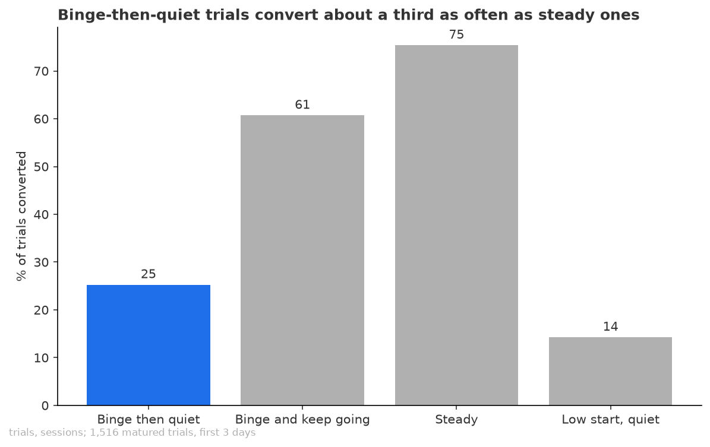

# Day-one bingers who go quiet convert far worse than steady users, but quiet is the problem, not the binge

**Date:** 2026-11-23
**For:** Head of growth
**Data runs to:** 2026-09-24
**Run folder:** outputs/2026-11-23_trial-day-one-binge-conversion/

## Objective
Do trial users who binge on day one and then go quiet convert worse than steady users? The head of growth decides whether onboarding emails should push trial users to spread their first week out. No size of gap was set as the bar, so this brief gives direction and size. Binge, quiet and steady are working definitions, listed below.

## Key Takeaways
- Trial users who binge on day one (8 or more sessions) and then go quiet (2 or fewer sessions on days 2 and 3) converted at 25.2%, against 75.4% for steady users, a gap of 50.1 percentage points (67% lower, relative); all matured trials convert at 53.2%.
- The gap is not small-sample noise: the binge-then-quiet range is 18.0% to 34.2% and the steady range is 72.0% to 78.5% (95% intervals), from 107 and 670 trials.
- Binge-then-quiet users still convert better than users with a light start who go quiet (14.2%), by 11.0 percentage points, so quiet after day one hurts conversion more than the binge itself.
- Among users who stay active on days 2 and 3, a day-one binge converts at 60.7%, against 75.4% for steady users, which is 14.7 percentage points lower.
- Looking at the full first week for trials still open on day 7, binge-then-quiet converts at 10.0% against 86.9% for steady, but this rests on only 50 trials.

## Recommendations
1. Change the onboarding emails to bring users back on days 2 and 3 rather than to hold back day one, since the weakest groups are the quiet ones (takeaways 1 and 3).
2. Run the change as a test on a random half of new trials before rolling it out, because this data only shows who stays active converts more, not that nudging them would raise conversion.
3. Agree the definitions and the size of gap that would justify the change; none was set.

## Analysis
### Binge-then-quiet trials convert about a third as often as steady ones.

Matured trials started 2026-08-01 to 2026-09-09 (1,516, none open), first 3 days, which ends before the first cancellation on day 4. Binge then quiet: 27 of 107 (25.2%). Binge and keep going: 88 of 145 (60.7%). Steady (1 to 5 sessions on day 1, 3 or more on days 2 and 3): 505 of 670 (75.4%). Low start and quiet: 41 of 288 (14.2%). Source: `data/group_results.csv`, built from `data/three_day.csv`. These groups are partial, not all trials.

### Quiet after day one is the weak spot, whether or not the user binged.
Within each follow-up level in `data/day1_by_follow_up.csv`, a day-one binge is not worse than a light start: with 0 to 2 sessions on days 2 and 3, conversion is 25.2% after a binge against 19.2% for 1 to 3 day-one sessions and 5.7% for none. With 6 or more sessions on days 2 and 3, conversion is 80.2% after a binge and 84.9% after a light start.

### The pattern is sharper over the full first week, on fewer trials.
For trials still open on day 7 (`data/week_survivors.csv`), binge-then-quiet converts at 10.0% (5 of 50; range 4.3% to 21.4%) against 86.9% for steady. Early cancellers are left out so they do not look quiet by construction, which also means this view starts from trials that survived the first week.

## Checks
**Review verdict:** Think on it

**Verified**
- One row per trial and per user (1,516 each), so the sessions join does not multiply rows; the count matches the matured trials in the trial snapshot note.
- No open trials in the window; cancellations start on day 4, after the 3-day window closes.
- The day-one by follow-up grid adds back to 1,516 trials.

**Changed after review**
- None.

**Not verified**
- Review finding 1 (caveat only): the gap is an association; it does not show spreading use out would raise conversion.
- Review finding 2 (caveat only): the thresholds are the analyst's working definitions, and the 7-day view rests on 50 trials and trials that survived to day 7.
- Review finding 3 (caveat only): the binge is not the driver; quiet users with a light start are worst.
- Not checked: country, device and plan splits, other thresholds, effect of existing emails.

**Source**
- Script: `analysis.py`; queries: `queries.sql`, run through course-db.
- Tables: `data/three_day.csv`, `data/week_survivors.csv`, `data/cancel_timing.csv`, `data/group_results.csv`, `data/day1_by_follow_up.csv`.
